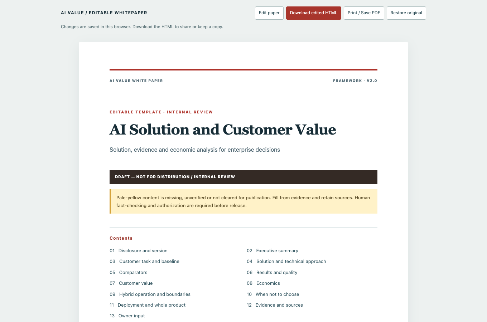

# AI Value White Paper Frame

**[简体中文](README.md) | English**

Turn existing solution materials into an enterprise AI value whitepaper. This project provides **brief** and **evidence-led** skills, plus editable Chinese and English HTML templates.


**[Download templates](https://github.com/joyzhou123123/ai-value-white-paper-frame/releases/download/v2.0.0/AI-Value-Editable-Templates.zip)** · [Preview](#quick-start-and-templates) · [Choose a skill](#choose-a-skill)

## Contents

- [Overview and value](#overview-and-value)
- [Framework architecture](#framework-architecture)
- [Components and files](#components-and-files)
- [Workflow](#workflow)
- [Quick start and templates](#quick-start-and-templates)
- [Choose a skill](#choose-a-skill)
- [What you get](#what-you-get)
- [Signal65 methodology mapping](#signal65-methodology-mapping)
- [Methods and validation](#methods-and-validation)

## Overview and value

AI solution evidence is often scattered across product overviews, architecture diagrams, performance reports, quotations and customer conversations. A decision-maker needs those materials connected to practical questions: **can the solution complete my task, are the results reliable, and is the investment worthwhile compared with what I use today?**

The framework organizes evidence into a traceable argument:

> Customer task and baseline → solution and configuration → realistic alternatives → test methods and results → task quality → business value and economics → limits and evidence

| Common gap | What the framework does | Value to the reader |
|---|---|---|
| Features and technical specifications only | Defines the user, task, current workflow and pain points | Shows who the solution serves and why it is relevant |
| Throughput or latency without business outcomes | Calls for acceptance criteria, quality, failures, retries and review | Connects speed with usable work |
| Comparisons chosen to favor one solution | Considers the status quo and realistic alternatives, including unfavorable results and poor-fit cases | Makes trade-offs visible |
| Economics limited to hardware price or theoretical savings | Records lifecycle hardware, software, operations, cloud and labor costs against passed tasks | Supports a reviewable investment discussion |
| A draft is needed before information is complete | Uses known material, highlights specific gaps and assigns owner fields | Produces a reviewable starting point and a concrete evidence plan |

**Example:** If a source provides only model throughput, the framework retains the figure and its configuration, then identifies missing task pass rate, end-to-end time and review cost. It does not turn throughput into an efficiency claim or calculate ROI without evidence. This illustrates the workflow; it is not a completed test.

### Core capabilities

1. **Evidence and boundaries:** Record source, date, conditions, publication rights and whether a claim is measured, calculated, vendor-stated or hypothetical. Highlight specific review gaps.
2. **Customer value:** Examine productivity, quality and risk, data control, response experience, cost and new capability against baselines, metrics and evidence where available.
3. **Comparable evaluation:** Define tasks, samples, quality thresholds, configurations, concurrency and statistics. Present successes and failures together and explain when alternatives fit better.
4. **Economics:** Under comparable workload and quality conditions, calculate period costs and cost per passed task; assess payback and sensitivities when inputs support it.
5. **Deliverables and collaboration:** Produce Chinese and English papers and editable HTML with role-based owner fields; complete human review before publication.

The framework helps plan, organize and check work. It does not run real tests, invent customer data or replace independent validation.

## Framework architecture

```text
INPUTS: product materials · customer needs · tests · costs · research
                              │
                              ▼
                  ┌─────────────────────────┐
                  │ Organize and grade      │
                  │ claims, sources, gaps   │
                  └────────────┬────────────┘
                               ▼
          ┌──────────────────────────────────────┐
          │ Choose the writing path              │
          │ Brief: organize and communicate      │
          │ Evidence-led: evaluate and compare  │
          └───────────────────┬──────────────────┘
                              ▼
     Customer task → options → quality & performance → value & cost
                              │
                              ▼
    Paper + editable HTML + highlighted gaps + owner intake
                              │
                              ▼
             Structured validation → human review → publication
```

Skills guide writing and evidence gathering; HTML supports editing and delivery; validators check structured data. The team remains responsible for gathering evidence, conducting tests, securing publication rights and final review.

## Components and files

| Component | Responsibility | Entry point |
|---|---|---|
| Brief skill | Create a readable paper from available material and identify gaps | [SKILL.md](skills/ai-value-brief-whitepaper/SKILL.md) · [Outline](skills/ai-value-brief-whitepaper/references/brief-framework.md) |
| Evidence-led skill | Organize real tasks, comparisons, customer value and economics | [SKILL.md](skills/ai-value-evidence-whitepaper/SKILL.md) · [Outline](skills/ai-value-evidence-whitepaper/references/evidence-framework.md) |
| Editable templates | Edit, complete tables and download HTML in a browser | [Download templates](https://github.com/joyzhou123123/ai-value-white-paper-frame/releases/download/v2.0.0/AI-Value-Editable-Templates.zip) · [Guide](skills/ai-value-brief-whitepaper/references/editable-html.md) |
| Owner intake | Turn evidence gaps into answerable questions | [One-page intake](skills/ai-value-brief-whitepaper/references/owner-intake.md) · [Detailed intake](skills/ai-value-brief-whitepaper/references/intake-template.md) |
| Validators | Check consistency of structured evidence and economic inputs | [Validation guide](skills/ai-value-brief-whitepaper/references/validation.md) · [Data template](skills/ai-value-brief-whitepaper/references/evidence.template.json) |

## Workflow

1. **Prepare inputs:** supply available product, customer, architecture, test and cost material; specify audience, region and language. Missing inputs can remain blank.
2. **Build an evidence trail:** connect claims to sources, distinguish measurements, calculations, vendor statements and assumptions, and capture conditions and publication rights.
3. **Choose a path:** use the brief for an initial narrative, or the evidence-led path for tasks, alternatives and methodology supporting a PoC or procurement decision.
4. **Analyze value and economics:** connect performance to passed tasks, workflows and costs. When supported by data, calculate `period cost ÷ tasks passing acceptance` and state the period and assumptions.
5. **Close gaps with owners:** highlight missing or unverified details, turn them into owner fields and place supported evidence in the narrative.
6. **Validate and deliver:** validate structured data; review facts, rights and layout; deliver editable HTML and the requested language versions.

## Quick start and templates

The image below shows the English template. The narrative is editable, owners can fill the tables, and pale yellow marks missing or unverified content.



**[Download editable templates in Chinese and English (ZIP)](https://github.com/joyzhou123123/ai-value-white-paper-frame/releases/download/v2.0.0/AI-Value-Editable-Templates.zip)**

Unzip the file and open `editable-whitepaper-en.html` or `editable-whitepaper-zh.html` in a browser. Select **Edit paper** to edit the narrative; owners can type directly in pale-yellow cells. Select **Download edited HTML** to save a copy.

> GitHub displays HTML as source code rather than running the template. Download the ZIP and open the file in your browser. Changes are stored only in the current browser and are not shared live; send the downloaded HTML when collaborating.

## Choose a skill

| | Brief whitepaper | Evidence-led whitepaper |
|---|---|---|
| Skill | `$ai-value-brief-whitepaper` | `$ai-value-evidence-whitepaper` |
| Best for | Writing an initial paper from incomplete materials | Evaluating tests, alternatives, task quality and economic value |
| Answers | What is the solution, who is it for and what is already supported? | How does it perform and cost under comparable conditions, and where are its limits? |
| Typical uses | Internal review, first customer conversations and organizing materials | PoC review, procurement, systematic tests and investment decisions |

Both skills default to separate Chinese and English outputs; request one language if preferred. Specific missing or unverified content receives a pale-yellow marker and a text label.

### Use a skill

1. Copy the two skill folders under `skills/` to `~/.codex/skills/`. Inspect any existing same-named folders before replacing them.
2. In a Codex session that supports Skills, attach available solution, test or cost materials and specify your audience, region and output format.
3. Name the skill in your prompt, for example:

```text
Use $ai-value-brief-whitepaper to create Chinese and English whitepapers from
my materials. Produce editable HTML, fill known content, highlight gaps in
yellow and list the fields owners need to complete.
```

For a fuller evaluation, use `$ai-value-evidence-whitepaper`. You can start with incomplete information; the skill uses what is available and identifies the evidence needed. For team input, start with the [one-page owner intake](skills/ai-value-brief-whitepaper/references/owner-intake.md).

## What you get

A paper normally follows the decision: **customer problem and baseline → solution and configuration → realistic alternatives → test results and quality → customer value → economics → limitations → sources and disclosures**.

The brief creates a readable starting point. The evidence-led paper goes further into workloads, methods, successes and failures, capacity and cost sensitivity. [Brief outline](skills/ai-value-brief-whitepaper/references/brief-framework.md) · [Evidence-led outline](skills/ai-value-evidence-whitepaper/references/evidence-framework.md)

| Content | What readers can see |
|---|---|
| Executive summary and baseline | Target customer, business problem, current process and main conclusions |
| Solution, comparison and testing | Components and configuration, realistic alternatives, test conditions, results and failures |
| Customer value and economics | Value dimensions, baseline, relevant costs, calculations and missing inputs |
| Limits and evidence | Poor-fit cases, sources and evidence grades, interests and publication rights |

With sufficient evidence, the paper can support solution evaluation. Where evidence is incomplete, it remains a highlighted internal review draft with an owner checklist.

## Signal65 methodology mapping

The evidence-led skill draws on Signal65's public approach of starting with real tasks, evaluating quality and capacity separately, and connecting outcomes to cost. It translates these ideas into a writing and evidence-gathering workflow:

| Signal65 focus | Corresponding practice | What the team must supply |
|---|---|---|
| **Real work** | Define customer roles, workflow, inputs, outputs and acceptance criteria | Representative tasks and the existing baseline |
| **Correct work** | Record task pass rates, failures and human review separately | Scoring rules, results and failure records |
| **Capacity and experience** | Distinguish per-request latency, aggregate throughput, concurrency and service targets | Configuration, workloads and tests at different concurrency levels |
| **Economics** | Compare realistic options and calculate period costs and cost per passed task | Hardware, cloud, operations, labor, volume and pass rates |
| **Methods and disclosure** | Record conditions, sources, authorship, interests and applicability | Raw records, price dates and publication permissions |

Where relevant, the framework covers local completion, escalation and external spend in hybrid AI. Testing must be performed by the solution or test team; the framework does not include Signal65's test platform, datasets or automated graders. It does not imply Signal65 participation, testing, certification or endorsement. [Signal65 methodology](https://pinnacle.signal65.com/measuring-correct-work-pg-1/)

## Methods and validation

### Methods that informed the framework

| Source | Role in this framework |
|---|---|
| [Equipt white-paper](https://github.com/Salah-XD/equipt/tree/main/plugins/equipt-content/skills/white-paper) | Organizes summary, analysis and recommendations around the reader's problem. |
| [research-paper](https://github.com/aniketkrs/research-paper) | Informs evidence, methods, citations and review. |
| Humanizer | Reduces formulaic language while preserving facts, figures and limits. |

The project includes adapted working methods, not the upstream projects' complete literature-fetching, statistical or conversion toolchains. [Detailed research methods](skills/ai-value-evidence-whitepaper/references/research-methods.md)

### Validation and publication

Each skill includes a structured evidence and economics validator. Ask Codex to prepare inputs using the [JSON template](skills/ai-value-brief-whitepaper/references/evidence.template.json) and run it; see the [validation guide](skills/ai-value-brief-whitepaper/references/validation.md). The script does not replace fact-checking, independent testing or authorization review.

Yellow markers and the draft label are for internal review. Review facts, test conditions and publication rights before releasing a paper externally.

---

Current version: **v2.0.0** · [Changelog](CHANGELOG.md) · [Project files](skills/)

Method credits: Equipt skill content is licensed [CC BY 4.0](https://github.com/Salah-XD/equipt/blob/main/LICENSE-CONTENT); research-paper is licensed [MIT](https://github.com/aniketkrs/research-paper/blob/main/LICENSE); editorial guidance refers to [Signs of AI writing](https://en.wikipedia.org/wiki/Wikipedia:Signs_of_AI_writing).
