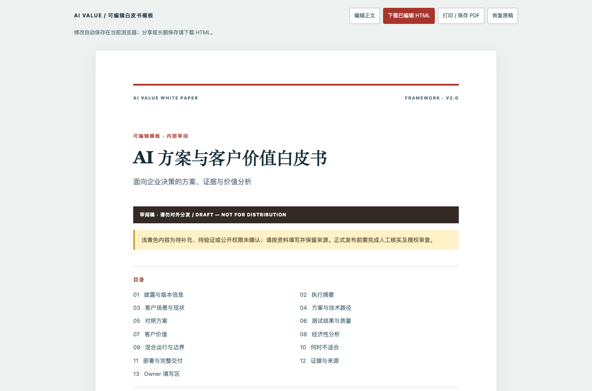

# AI Value White Paper Frame

**简体中文 | [English](README.en.md)**

把现有方案资料整理成专业的 AI Value 白皮书。项目提供**简版**和**证据型**两套 Skill，以及可直接填写的中英文 HTML 模板。

## 先看看模板

下图是中文版模板的实际界面。正文可以编辑，Owner 表格可以直接填写；浅黄色表示需要补充或验证。



<details>
<summary>查看 Owner 表格预览</summary>


</details>

**[下载中英文可编辑模板（ZIP）](https://github.com/joyzhou123123/ai-value-white-paper-frame/releases/download/v2.0.0/AI-Value-Editable-Templates.zip)**

下载后解压，双击 `editable-whitepaper-zh.html` 或 `editable-whitepaper-en.html`，用浏览器打开即可。点击顶部 **“编辑正文”** 修改文章；Owner 可以直接点击浅黄色单元格填写。完成后点击 **“下载已编辑 HTML”** 保存文件。

> GitHub 文件页面展示的是 HTML 源码，不会直接运行这个模板。请下载上面的 ZIP 后在浏览器打开。修改暂存在当前浏览器，不会实时同步给其他人；分享时请发送下载后的 HTML 文件。

## 两套 Skill 怎么选

| | 简版白皮书 | 证据型白皮书 |
|---|---|---|
| Skill 名称 | `$ai-value-brief-whitepaper` | `$ai-value-evidence-whitepaper` |
| 适合 | 资料还不完整，需要先写一版方案介绍 | 需要评估测试、对照方案、业务质量和经济价值 |
| 主要回答 | 方案是什么、适合谁、现有资料支持什么 | 在可比条件下，方案表现如何、成本如何、有哪些限制 |
| 常见场景 | 内部评审、首次客户沟通、材料梳理 | PoC 复盘、采购评估、系统测试和投资决策 |

两套都默认分别输出中文版和英文版；也可以明确指定只要一种语言。缺失或待验证的具体内容会标浅黄色，并用文字说明。

## 如何使用 Skill

1. 将本项目 `skills/` 下的两个 Skill 文件夹复制到 `~/.codex/skills/`。已有同名文件夹时，请先检查内容。
2. 在支持 Skills 的 Codex 会话中，附上已有方案、测试或成本资料，说明读者、地区和交付格式。
3. 在消息中明确写出 Skill 名称，例如：

```text
使用 $ai-value-brief-whitepaper，基于我提供的资料写中英文白皮书。
请生成可编辑 HTML，已有内容先写入，缺失内容标黄，并列出 Owner 填写项。
```

需要完整评测时，将名称换成 `$ai-value-evidence-whitepaper`。资料不齐也可以开始；Skill 会先利用已有内容，并列出需要补证的具体字段。团队协作可以先使用 [Owner 一页填写表](skills/ai-value-brief-whitepaper/references/owner-intake.md)。

## 最终会形成什么

白皮书围绕客户决策展开，通常包括：**客户问题与现状 → 方案与配置 → 现实对照 → 测试结果与质量 → 客户价值 → 经济账 → 适用边界 → 来源与披露**。

简版先用已有资料形成可读初稿；证据型版本进一步补充工作负载、测试方法、成功与失败、系统容量及成本敏感性。[简版详细结构](skills/ai-value-brief-whitepaper/references/brief-framework.md) · [证据型详细结构](skills/ai-value-evidence-whitepaper/references/evidence-framework.md)

## 借鉴的方法

| 参考来源 | 帮助解决什么问题 |
|---|---|
| [Equipt white-paper](https://github.com/Salah-XD/equipt/tree/main/plugins/equipt-content/skills/white-paper) | 围绕读者问题组织摘要、分析和建议。 |
| [research-paper](https://github.com/aniketkrs/research-paper) | 整理研究来源、测试方法、引用和审阅。 |
| Humanizer | 减少套话和空泛宣传，保留事实、数字及限制。 |
| Signal65 公开方法 | 将真实任务、质量、容量和成本放在一起分析。 |

与 Signal65 的对照重点是：**任务是否正确完成、系统能承载多少工作、每个合格任务花多少钱，以及测试条件能否复核**。参考方法不代表 Signal65 参与、测试、认证或背书。阅读 [Signal65 方法说明](https://pinnacle.signal65.com/measuring-correct-work-pg-1/) · [本项目的详细研究方法](skills/ai-value-evidence-whitepaper/references/research-methods.md)

本项目内置的是经过调整的工作方法，不包含原项目的完整文献抓取、统计和转换工具链。

## 校验与发布

每套 Skill 带有证据和经济账校验脚本。需要时，让 Codex 根据 [JSON 模板](skills/ai-value-brief-whitepaper/references/evidence.template.json)整理输入并运行；具体字段和命令见[校验说明](skills/ai-value-brief-whitepaper/references/validation.md)。脚本不能替代事实核查、独立测试或授权审核。

黄底和“请勿对外分发”标记用于内部审阅。正式发布前，请完成事实、测试条件及资料公开权限的人工审核。

---

当前版本：**v2.0.0** · [更新记录](CHANGELOG.md) · [项目文件](skills/)

方法参考：Equipt 技能内容采用 [CC BY 4.0](https://github.com/Salah-XD/equipt/blob/main/LICENSE-CONTENT)；research-paper 项目采用 [MIT](https://github.com/aniketkrs/research-paper/blob/main/LICENSE)；语言审校参考 [Signs of AI writing](https://en.wikipedia.org/wiki/Wikipedia:Signs_of_AI_writing)。
