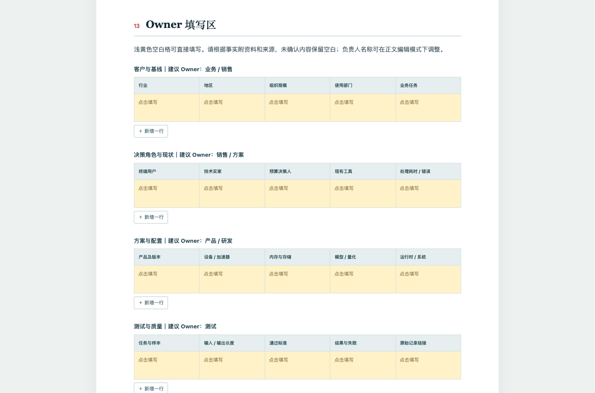

# AI Value White Paper Frame

**简体中文 | [English](README.en.md)**

把现有方案资料整理成专业的 AI Value 白皮书。项目提供**简版**和**证据型**两套 Skill，以及可直接填写的中英文 HTML 模板。


**[下载中英文模板](https://github.com/joyzhou123123/ai-value-white-paper-frame/releases/download/v3.0.0/AI-Value-Editable-Templates.zip)** · [查看模板](#快速开始与模板) · [选择 Skill](#两套-skill-怎么选)

## 目录

- [项目概览与价值](#项目概览与价值)
- [框架架构](#框架架构)
- [组件与文件](#组件与文件)
- [工作流程](#工作流程)
- [快速开始与模板](#快速开始与模板)
- [两套 Skill 怎么选](#两套-skill-怎么选)
- [最终会形成什么](#最终会形成什么)
- [与 Signal65 的方法如何对照](#与-signal65-的方法如何对照)
- [参考方法与校验](#参考方法与校验)

## 项目概览与价值

AI 方案资料通常散落在产品介绍、架构图、性能报告、报价和客户交流记录里。把这些资料排成一篇文章并不难，难的是回答客户真正关心的问题：**这个方案能否完成我的任务，效果是否可靠，和现有做法相比值不值得投入？**

这个框架把资料组织成一条可追溯的论证链：

> 客户任务与现状 → 方案和配置 → 现实替代方案 → 测试方法与结果 → 任务质量 → 业务价值与经济账 → 适用边界与证据

| 常见问题 | 框架如何处理 | 对读者的价值 |
|---|---|---|
| 只有产品功能和技术参数 | 先定义客户角色、业务任务、当前流程及痛点 | 知道方案适合谁、解决什么问题 |
| 只有吞吐或延迟，没有业务结果 | 补充任务验收、正确率、失败、重试及人工复核 | 判断速度提升能否转化为可用结果 |
| 只和对自己有利的方案比较 | 同时考虑现有做法和现实替代方案，说明不利结果与不适用情况 | 看清选择之间的取舍 |
| 经济账只有设备价或理论节省 | 列出实际周期内的设备、软件、运维、云调用及人工成本，并按合格任务数核算 | 用可复核的假设讨论投入，而不是套用收益口号 |
| 信息不齐仍需要先成稿 | 已有内容先写，具体缺口标黄并进入 Owner 填写表 | 快速形成可评审的初稿，知道下一步要找谁补什么 |

**使用示例：**当资料只给出模型吞吐时，框架会保留该结果及其配置条件，并提示补充任务通过率、端到端耗时和人工复核成本；这些信息缺失时不会把吞吐直接写成“效率提升”或自动推算 ROI。这个例子说明工作方式，不代表已经完成任何测试。

### 核心能力

1. **证据与边界**：为主张记录来源、日期、条件、公开权限，以及实测、计算、厂商说明或假设等证据类型。审阅稿中的具体缺口标黄，避免把规划和估算写成事实。
2. **客户价值拆解**：从生产力、质量与风险、数据控制、响应体验、成本和新增能力分析，而不是只罗列功能。每个维度尽量对应现状基线、指标和证据。
3. **可比评测**：定义任务、样本、质量门槛、硬件软件、并发和统计方法；把成功与失败放在一起，说明替代方案在哪些条件下更合适。
4. **经济性分析**：在可比任务和质量条件下，按实际核算周期整理成本；通过“总成本 ÷ 通过验收的任务数”计算合格任务成本，并在数据允许时分析回收期和敏感性。
5. **可交付与协作**：生成中英文白皮书及可编辑 HTML，提供按角色划分的 Owner 填写入口；人工审核后再处理公开引用和发布权限。

框架帮助规划、整理与检查，但不会替团队完成真实测试，也不能凭空生成缺失的客户数据或替代独立验证。

## 框架架构

```text
输入：产品资料 · 客户需求 · 测试报告 · 成本数据 · 公开研究
                              │
                              ▼
                  ┌────────────────────────┐
                  │  资料整理与证据分级     │
                  │  主张 · 来源 · 条件 · 缺口│
                  └───────────┬────────────┘
                              ▼
          ┌────────────────────────────────────┐
          │            写作路径选择             │
          │  简版：资料梳理与方案沟通            │
          │  证据型：评测、对照与经济性分析        │
          └─────────────────┬──────────────────┘
                            ▼
       客户任务 → 方案与对照 → 质量与性能 → 价值与成本
                            │
                            ▼
       白皮书正文 + 可编辑 HTML + 标黄缺口 + Owner 补充表
                            │
                            ▼
                结构化校验 → 人工审核 → 发布
```

这是框架的工作路径：Skill 根据输入组织写作和补证；HTML 提供编辑与交付界面；校验脚本检查结构化数据。资料收集、真实测试、公开授权与最终审核仍由使用团队负责。

## 组件与文件

| 组件 | 职责 | 入口 |
|---|---|---|
| 简版 Skill | 根据现有资料形成可阅读的方案白皮书，识别缺口 | [SKILL.md](skills/ai-value-brief-whitepaper/SKILL.md) · [文章结构](skills/ai-value-brief-whitepaper/references/brief-framework.md) |
| 证据型 Skill | 组织真实任务、可比评测、客户价值及经济账 | [SKILL.md](skills/ai-value-evidence-whitepaper/SKILL.md) · [文章结构](skills/ai-value-evidence-whitepaper/references/evidence-framework.md) |
| 可编辑模板 | 浏览器中编辑正文、填写表格并下载 HTML | [下载中英文模板](https://github.com/joyzhou123123/ai-value-white-paper-frame/releases/download/v3.0.0/AI-Value-Editable-Templates.zip) · [使用说明](skills/ai-value-brief-whitepaper/references/editable-html.md) |
| Owner 填写入口 | 将待补证据拆成团队可以回答的问题 | [一页填写表](skills/ai-value-brief-whitepaper/references/owner-intake.md) · [详细输入](skills/ai-value-brief-whitepaper/references/intake-template.md) |
| 校验工具 | 检查结构化证据与经济账输入的一致性 | [校验说明](skills/ai-value-brief-whitepaper/references/validation.md) · [数据模板](skills/ai-value-brief-whitepaper/references/evidence.template.json) |

## 工作流程

1. **准备输入**：提供已有的产品、客户、架构、测试和成本材料，说明目标读者、适用地区和交付语言。没有的数据可以留空。
2. **建立证据链**：提取有来源的主张，区分实测、计算、厂商说明和假设，记录条件及可公开范围。
3. **选写作路径**：资料有限时先用简版形成叙事；需要支持采购或 PoC 评估时，使用证据型框架组织任务、对照和方法。
4. **分析价值与经济账**：将性能关联到合格任务、业务流程及成本。数据允许时计算 `周期总成本 ÷ 通过验收的任务数`，并说明时间范围和假设。
5. **协同补证**：将缺失或待验证的具体内容标黄，拆进 Owner 表格；已有证据写入正文，不将估算当成实测。
6. **校验与交付**：对结构化数据运行校验，人工复核事实、权限和排版，交付可编辑 HTML 与对应语言的白皮书。

## 快速开始与模板

下图是中文版模板的实际界面。正文可以编辑，Owner 表格可以直接填写；浅黄色表示需要补充或验证。


<details>
<summary>查看 Owner 表格预览</summary>



</details>

**[下载中英文可编辑模板（ZIP）](https://github.com/joyzhou123123/ai-value-white-paper-frame/releases/download/v3.0.0/AI-Value-Editable-Templates.zip)**

下载后解压，双击 `editable-whitepaper-zh.html` 或 `editable-whitepaper-en.html`，用浏览器打开即可。点击顶部 **“编辑正文”** 修改文章；Owner 可以直接点击浅黄色单元格填写。完成后点击 **“下载已编辑 HTML”** 保存文件。

> GitHub 文件页面展示的是 HTML 源码，不会直接运行这个模板。请下载上面的 ZIP 后在浏览器打开。修改暂存在当前浏览器，不会实时同步给其他人；分享时请发送下载后的 HTML 文件。

## 两套 Skill 怎么选

| | 简版白皮书 | 证据型白皮书 |
|---|---|---|
| Skill 名称 | `$ai-value-brief-whitepaper` | `$ai-value-evidence-whitepaper` |
| 适合 | 资料还不完整，需要先写一版方案介绍 | 需要评估测试、对照方案、业务质量和经济价值 |
| 主要回答 | 方案是什么、适合谁、现有资料支持什么 | 在可比条件下，方案表现如何、成本如何、有哪些限制 |
| 常见场景 | 内部评审、首次客户沟通、材料梳理 | PoC 复盘、采购评估、系统测试和投资决策 |

两套都默认分别输出中文版和英文版；也可以明确指定只要一种语言。缺失或待验证的具体内容会标浅黄色，并用文字说明。

V3.0 增加逐字段 Owner 表、数据状态、完整产品名称及自然措辞规则。单文件双语切换与同步属于按需生成能力，需要可用的翻译引擎；仓库现有下载包仍是两个独立 HTML 模板，并不内置自动双向翻译。

### 如何使用 Skill

1. 将本项目 `skills/` 下的两个 Skill 文件夹复制到 `~/.codex/skills/`。已有同名文件夹时，请先检查内容。
2. 在支持 Skills 的 Codex 会话中，附上已有方案、测试或成本资料，说明读者、地区和交付格式。
3. 在消息中明确写出 Skill 名称，例如：

```text
使用 $ai-value-brief-whitepaper，基于我提供的资料写中英文白皮书。
请生成可编辑 HTML，已有内容先写入，缺失内容标黄，并列出 Owner 填写项。
```

需要完整评测时，将名称换成 `$ai-value-evidence-whitepaper`。资料不齐也可以开始；Skill 会先利用已有内容，并列出需要补证的具体字段。团队协作可以先使用 [Owner 一页填写表](skills/ai-value-brief-whitepaper/references/owner-intake.md)。

## 最终会形成什么

白皮书围绕客户决策展开，通常包括：**客户问题与现状 → 方案与配置 → 现实对照 → 测试结果与质量 → 客户价值 → 经济账 → 适用边界 → 来源与披露**。

简版先用已有资料形成可读初稿；证据型版本进一步补充工作负载、测试方法、成功与失败、系统容量及成本敏感性。[简版详细结构](skills/ai-value-brief-whitepaper/references/brief-framework.md) · [证据型详细结构](skills/ai-value-evidence-whitepaper/references/evidence-framework.md)

| 内容 | 读者能看到什么 |
|---|---|
| 执行摘要与客户现状 | 目标客户、业务问题、当前做法和文章主要结论 |
| 方案、对照与测试 | 组件和配置、现实替代方案、测试条件、结果及失败记录 |
| 客户价值与经济账 | 价值维度、当前基线、相关成本、计算过程及缺失输入 |
| 适用边界与证据 | 不适合的场景、来源与证据等级、作者利益和公开权限 |

证据充分时，文章用于支持方案评估；证据尚不完整时，先形成标黄的内部审阅稿和 Owner 补充清单。

## 与 Signal65 的方法如何对照

证据型 Skill 借鉴 Signal65 公开研究中从真实任务出发、分别衡量质量和容量、再分析成本的思路。它把这些方法转成方案团队可执行的写作与补证流程：

| Signal65 关注点 | 框架中的对应做法 | 需要团队提供什么 |
|---|---|---|
| **实际任务** | 明确客户角色、工作流、输入输出和验收标准 | 有代表性的任务样本和现有流程 |
| **工作是否正确** | 分开记录任务通过率、失败类型和人工复核 | 评分规则、测试结果和失败记录 |
| **系统容量与体验** | 区分单请求延迟、总吞吐、并发和服务门槛 | 配置、负载及不同并发下的测试数据 |
| **经济性** | 对比实际替代方案，计算周期成本及每个合格任务成本 | 设备、云、运营、人力、用量与通过率 |
| **方法与披露** | 记录测试条件、来源、作者和利益关系，保留适用边界 | 原始记录、报价日期和公开授权 |

框架还会根据需要处理混合 AI 的本地完成比例、升级调用和外部费用。具体评测必须由方案或测试团队执行，框架本身不包含 Signal65 的测试平台、数据集或自动评分程序。参考方法不代表 Signal65 参与、测试、认证或背书。[Signal65 方法说明](https://pinnacle.signal65.com/measuring-correct-work-pg-1/)

## 参考方法与校验

### 参考方法

| 参考来源 | 在本框架中的作用 |
|---|---|
| [Equipt white-paper](https://github.com/Salah-XD/equipt/tree/main/plugins/equipt-content/skills/white-paper) | 围绕读者问题组织摘要、分析和建议。 |
| [research-paper](https://github.com/aniketkrs/research-paper) | 整理研究来源、测试方法、引用与审阅。 |
| Humanizer | 减少套话和空泛宣传，保留事实、数字及限制。 |

本项目内置的是经过调整的工作方法，不包含原项目的完整文献抓取、统计和转换工具链。[查看详细研究方法](skills/ai-value-evidence-whitepaper/references/research-methods.md)

### 校验与发布

每套 Skill 带有证据和经济账校验脚本。需要时，让 Codex 根据 [JSON 模板](skills/ai-value-brief-whitepaper/references/evidence.template.json)整理输入并运行；具体字段和命令见[校验说明](skills/ai-value-brief-whitepaper/references/validation.md)。脚本不能替代事实核查、独立测试或授权审核。

黄底和“请勿对外分发”标记用于内部审阅。正式发布前，请完成事实、测试条件及资料公开权限的人工审核。

---

当前版本：**v3.0.0** · [更新记录](CHANGELOG.md) · [项目文件](skills/)

方法参考：Equipt 技能内容采用 [CC BY 4.0](https://github.com/Salah-XD/equipt/blob/main/LICENSE-CONTENT)；research-paper 项目采用 [MIT](https://github.com/aniketkrs/research-paper/blob/main/LICENSE)；语言审校参考 [Signs of AI writing](https://en.wikipedia.org/wiki/Wikipedia:Signs_of_AI_writing)。
